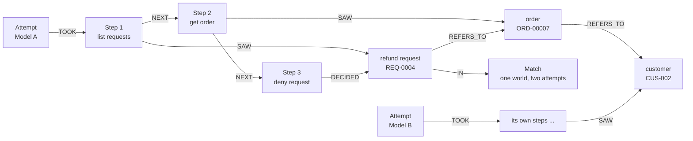
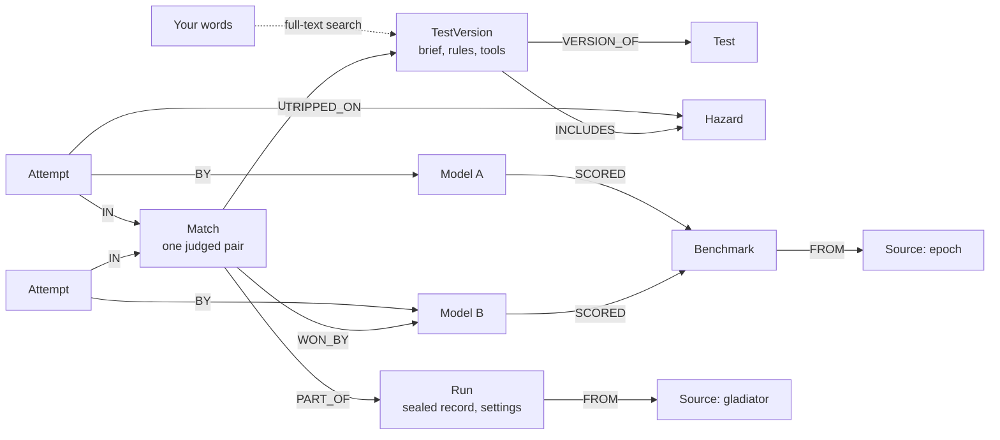

# Gladiator Ledger

**Of these two AI models, which does *this* task better, how sure is that, and what should I build?**

Two models that look alike on a leaderboard can behave very differently on your workflow. Ledger holds head-to-head
matches in a [Relate](https://relatedb.ai) graph, where two models played the same freshly generated worlds of a
tool-using task, and answers with a **task claim** in two parts: is each model **fit for this task** under your
tolerance for mistakes, and which one **did it better** head to head. Then it writes a **spec** you can build
from. It never ranks models in general, and when the evidence is thin or level it names no winner.

**There is no leaderboard here, and there cannot be one.** A result belongs to a task. What Ledger holds is a record
for each tested workflow; for your own flow, that record is a starting point (the nearest thing already tested, and
which two models are worth racing), and the match on your task is the evidence.

**Where Relate comes in.** [Relate](https://relatedb.ai) is the store and the query engine, not an export target.
The match records are loaded into one Relate graph, and every answer is a Cypher query over it. A Relate full-text
index finds the workflow you describe. Storage mode: the embedded Python library with a single-file store
(`data/ledger.rl`), opened read-only; the browser demo runs Relate's WebAssembly build with an in-memory store
built from the same statements; and an MCP server gives AI assistants the same graph, read-only.

**The graph goes down to the step.** Every attempt is a route through a small world of connected records (a refund
request, its order, the order's customer), and both models walked the same world. So a question about *how* a
model works is a pattern in the graph, and a new one can be asked of every attempt on file without playing a
match: [How they got there](#how-they-got-there-ask-the-record-a-new-question).

> Entry for the Relate by Neo4j hackathon (Nov–Dec 2026). The repository ships a Relate store built from **37 real
> suite matches between 12 models** (closed and open-weights) and every live race run since, so everything below
> reproduces from a clean clone with **no API keys and no cost**.

> **The record grows.** A live race on the hosted runner is sealed by the same engine on the same tests, imported
> here and counted like any other match played under the same conditions, so the page and the commands answer from
> more matches as races are run. The figures printed in this README are the record as it stood at 05:00 UTC on
> Nov 26, 2026 (49 matches). Add `--until 2026-11-26T05:00` to a command and what you run is exactly what you read;
> leave it off for the record as it is today. Corrections to the data, and one change to how fitness is judged,
> are described under [Corrections](#corrections).

## The idea in one table
Claude Haiku 5.5 and DeepSeek V4.1 Flash score 0.9 points apart on a published capability index: a tie on paper.
They cost about the same too, half a cent an attempt. Here are the two on four workflows, 41 to 43 scenarios each,
both models on the same generated world every time
(any row: `uv run ledger verdict <task> --a "haiku 5.5" --b deepseek-v4.1 --until 2026-11-26T05:00`).

| Task | Scenarios won (Haiku / DeepSeek) | Attempts with the right result (Haiku / DeepSeek) | For one person | For a business running it unattended |
|---|---|---|---|---|
| Refund queue | 37 / 6 | 99% / 100% | **Use Haiku**: both are fit, and it did it better | neither is fit |
| Incident triage | 30 / 11 | 91% / 97% | **Use Haiku**: both are fit, and it did it better | neither is fit |
| Access review | 19 / 22 | 98% / 99% | both fit, no settled lead | **Use DeepSeek**: Haiku is not fit |
| Inventory transfer | 20 / 19 | 87% / 95% | both fit, no settled lead | neither is fit |

One model is not "better". Haiku won 106 of the 166 scenarios and is the settled choice on two workflows. Yet
DeepSeek got the right result more often on all four, and on access reviews it is the only one of the two a
business could run unattended: Haiku made one wrong access decision in 81 attempts.

The two columns disagree because they measure different things. **The right result** asks whether every decision
was right. **Scenarios won** also counts how a model got there. On the refund queue both models decide the
refunds correctly, and 28 of Haiku's 37 wins are on process alone: in two attempts of three, DeepSeek decides a
request before looking up a record the brief tells it to read. Whether that matters is not Ledger's call. It is a
fault with a level, and **the right answer depends on who is asking**: for one person it is minor and both models
are fit; for a business it is serious and neither is. Ledger makes both calls, shows the count behind each, says
"leaning" when a lead could still be chance, and lets you change the rule.

That last point is in the table too. With sixteen scenarios each, DeepSeek led access review and inventory
transfer 11 to 5, and Ledger called both "leaning, not settled". Twenty-five more scenarios levelled them.

## Three ways to use it
All three walk the same loop over the same graph and give the same answers (the page is checked against the
command line in CI).

### 1. In your browser
**Live: https://ledger.gladiatorbench.com/** (published from this repository after every change that
passes the checks). The `site/` folder is a static page. It builds the graph in your browser with Relate's WebAssembly build and walks
the loop: describe a flow, pick two models, choose whose tolerance applies, read the verdict, download the spec. Every
scenario behind a verdict can be replayed as a race: both models on the same world, step by step, at the pace they
really ran. Under the replay the page loads that scenario's steps into its graph and lays the two routes side by
side, item by item: what each model decided, and whether it had by then seen the records the item depends on.
"How they got there", under the verdict, loads the steps of every scenario of the task and asks the process
questions of them. Give one a level and the verdict above is judged with it
([How they got there](#how-they-got-there-ask-the-record-a-new-question)).

**Live races (hackathon judges for now, coming soon for everyone).** Under the recorded scenarios the page can
ask a [Gladiator race runner](https://github.com/Loothore907/gladiator-core/blob/main/docs/DEPLOYMENT.md) for one
fresh scenario between the two models chosen in step 2 (each model's card says whether it can race live). It first states
what the record expects, or that the two have never met on this task, then streams the race as it happens, then
says whether the result was in line with the record or against it. The sealed result is then imported into the
record (the runner starts the import when a race ends, and a scheduled job picks up anything missed), and from then
on the verdict counts it, provided it was played under the record's conditions: the same settings, difficulty and
scoring. A race at another level is kept on file, and the verdict says so and leaves it out. A batch plays 10 or 25
scenarios in one go, and one model on both lanes is a consistency
check that is never counted as a head-to-head. Judges sign in once, with the "Judge sign-in"
button and their access code (or an invitation link that carries it); nobody else is shown a race button. The panel shows what is left of each provider's live budget, and a
model leaves the list when its provider's budget is used up. To run one on your own
machine with your own keys: start `gladiator serve` in a gladiator-core checkout with
`--origin http://localhost:8000`, then open the page with `?runner=http://127.0.0.1:8787`. No server, no keys, nothing leaves
the tab.

```bash
python3 -m http.server --directory site 8000    # then open http://localhost:8000
```

### 2. Through your own AI assistant
Ledger is an MCP server, so an assistant can walk the loop for you in plain language: *"I need a model for handling
refund requests. I'm using Haiku 5.5. What should I compare it with, and which is better at this?"*

```bash
uv run ledger mcp        # serves data/ledger.rl on stdio, read-only
```
This repository's `.mcp.json` registers it for clients that read project configuration (open the folder in Claude
Code and the `ledger` tools appear). For others, add:

```json
{"mcpServers": {"ledger": {"command": "uv", "args": ["run", "--directory", "/path/to/gladiator-ledger", "ledger", "mcp"]}}}
```
The tools are `find_flows`, `who_has_played`, `suggest_opponents`, `verdict`, `how_they_worked`, `same_world`,
`write_spec`, `describe_graph` and
`read_graph` (read-only Cypher). They call the same code as the command line. The server also sends the assistant
Ledger's rules: task claims only, "leaning" stays "leaning", and no winner the evidence does not name. Ledger needs
no API key; the assistant is yours. Step-by-step setup: [docs/ASSISTANT.md](docs/ASSISTANT.md).

### 3. From the command line
Needs Python 3.12+ and [uv](https://docs.astral.sh/uv/). Under five minutes; works the same on Linux, macOS and
Windows (CI checks Linux and Windows on every change).

```bash
git clone https://github.com/Loothore907/gladiator-ledger
cd gladiator-ledger
uv sync
uv run ledger verdict refund-queue --a "haiku 5.5" --b deepseek-v4.1
```

## The loop, step by step

### Step 1. Describe your flow
```bash
uv run ledger flows "an agent that handles refund requests for damaged orders"
```
```text
Closest tested workflows to: 'an agent that handles refund requests for damaged orders'  (searched for: refund
requests damaged orders request order)      (output wrapped and shortened here)

  gladiator/refund-queue  (Refund queue, version 2.2.0)  match 6.03
    12 models, 232 judged pairs; modelled on tau-bench (style)
    You run the refund queue for an online shop. Go through every open refund request, look up its order ...

  gladiator/inventory-transfer  (Inventory transfer, version 1.2.0)  match 2.54
    ...
```
A keyword search (a Relate **full-text index** over each workflow's title, brief and rules) that then walks the
graph to what is known about each match: how many models and judged pairs stand behind it. When nothing matches it
says so and lists what exists. It never invents a match. (Output of Nov 26, 2026. This command reads the whole
record, so the pair counts grow as live races are imported.)

### Step 2. Pick a fair opponent
```bash
uv run ledger opponents "haiku 5.5" --open-only
```
```text
anthropic:claude-haiku-5-5  (Claude Haiku 5.5)
Epoch Capabilities Index: 160.3  (range 158.2 to 162.7)

Closest on paper, open weights only:
  model                                         score     gap  ranges overlap  weights  in Ledger
  epoch:Kimi K3.1 Pro                           161.2   +0.87  yes             open     no matches yet
  openrouter:deepseek/deepseek-v4.1-flash-1017  159.4   -0.92  yes             open     166 pairs already played against it
  ...
```
Ledger never ranks models by a published score. It uses one, [Epoch AI's](https://epoch.ai/benchmarks)
Capabilities Index, for a narrower question: which models are close enough on paper that a head-to-head is worth
running? Haiku and DeepSeek are less than one point apart, with overlapping ranges. On the tasks they are not a
tie: Haiku is the settled choice on two of the four workflows, and for a business only DeepSeek is fit on a third.
**Close on paper, different on the task**: that gap is what Ledger is for. (Output of Nov 26, 2026; the count of
pairs already played grows with live races.)

### Step 3. Get the verdict
```bash
uv run ledger verdict refund-queue --a "haiku 5.5" --b deepseek-v4.1 --until 2026-11-26T05:00
```
```text
Use anthropic:claude-haiku-5-5: both are fit for this task and it did it better.
                                                                       (output wrapped and shortened here)
Fit for this task (personal tolerance):
  anthropic:claude-haiku-5-5: fit. Right result in 80 of 81 attempts (99%; bar 80%); 68 of them
  also followed the process the test asks for.
      tolerated: wrong decision (serious) in 1 of 81
      tolerated: acted without reading (minor) in 12 of 81
  openrouter:deepseek/deepseek-v4.1-flash-1017: fit. Right result in 95 of 95 attempts (100%; bar 80%);
  30 of them also followed the process the test asks for.
      tolerated: acted without reading (minor) in 65 of 95

Head to head: anthropic:claude-haiku-5-5 does this task better
  43 judged pairs on the same generated worlds: anthropic:claude-haiku-5-5 won 37,
  openrouter:deepseek/deepseek-v4.1-flash-1017 won 6, 0 tied (sign test p = 0.0)
  decided: 28 on success, 15 on efficiency

Notes:
  - In 28 of the 37 scenarios anthropic:claude-haiku-5-5 won, both got the right result: it won them on
    process, by following the steps the test asks for where the other did not.
```
**Fit comes first, and it has two parts.** The **result**: in enough of its attempts, every decision was right and
nothing was left undone. That is the bar. The **process**: how it got there, read from the faults it made. Each
fault has a level: **unforgivable** (one attempt with it makes the model unfit, shown with its count), **serious**
(fine if rare) or **minor** (shown, never decides). The two are kept apart on purpose. The test passes an attempt
only when both the result and the process are right, so DeepSeek "passes" 30 of its 95 refund attempts while
getting every one of them right. Whether the skipped lookup matters is your call, not the bar's.

Every attempt the model made on the task under the same conditions counts, whoever the opponent was, so a model's
fitness for a task reads the same in every verdict. The same fault is not equally serious everywhere: paying a
refund twice breaks a business, paging the on-call twice is an annoyance. Two tolerances ship, and every level can
be overruled:

```bash
uv run ledger verdict refund-queue --a "haiku 5.5" --b deepseek-v4.1 --until 2026-11-26T05:00 --profile enterprise
uv run ledger verdict refund-queue --a "haiku 5.5" --b deepseek-v4.1 --until 2026-11-26T05:00 --unforgivable "acted without reading"
```
Both of those answer "neither is fit": a business will not accept a skipped lookup in more than 2% of attempts,
and a reader who calls it unforgivable accepts none. `personal` needs the right result in 80% of attempts and
allows a serious fault in 10% of them; `enterprise` needs 90% and allows 2%. The defaults are in
[`ledger/policy.py`](ledger/policy.py).

**Then the head to head.** Only the pairs where these two met count, and each pair is judged as the engine judges
it: passing beats not passing; if both passed or neither did, the one that got further wins, then the more
efficient. So the head to head does count process, and a verdict says how many scenarios were won on it. The
result is one of four: **better** (settled), **leaning** (ahead, but it could still be chance), **no real
difference shown**, or **not enough evidence** (fewer than eight pairs). When neither model is fit, Ledger lists
the tested models that are, cheapest first, or says that none is.

### Step 4. Get the spec
```bash
uv run ledger spec refund-queue --a "haiku 5.5" --b deepseek-v4.1 --until 2026-11-26T05:00 --out spec.md
```
One document in four layers:

- **Decision.** The answer to act on (here: use Haiku; both are fit and it did the task better), each model's
  fitness with its reasons, the pair counts, and the comparison.
- **Blueprint.** The job and the rules exactly as tested, the tools the flow needs, the settings the result holds
  for (reasoning effort, output limit, a hard budget of $0.12 per attempt), and for every hazard an autonomy call:
  **can run alone** where the chosen model never fell for it in these matches, **needs a guard** where it did,
  with the guard spelled out ("refuse an action on an item until the lookups it depends on have been made").
- **Cost.** What these head-to-head attempts cost each model: per attempt, per *passed* attempt (failures
  included), per 1,000 runs, how much of the reading was served from the provider's cache, and where each
  figure comes from (the provider's bill, a re-pricing, or the list price).
- **Evidence.** The sealed match records, the test's fingerprint and the engine version.

It ends with the same content as JSON, and it says plainly what it is: a result for this task, in a simulated world,
under these settings. A starting point for the real flow, to be tested again once built.

Two more reports are written from the same verdict, so the three cannot disagree:

```bash
uv run ledger spec refund-queue --a "haiku 5.5" --b deepseek-v4.1 --until 2026-11-26T05:00 --report cost       # the cost breakdown
uv run ledger spec refund-queue --a "haiku 5.5" --b deepseek-v4.1 --until 2026-11-26T05:00 --report evidence   # the evidence report
uv run ledger spec refund-queue --a "haiku 5.5" --b deepseek-v4.1 --until 2026-11-26T05:00 --report all --out spec.md
```
The **cost breakdown** adds every scenario's cost for both models. The **evidence report** lists each model's
fitness with every fault and its count, and every scenario with its winner, how it was decided and its sealed
record. `--report all --out spec.md` writes `spec.md`, `spec.cost.md` and `spec.evidence.md`. On the page the
same three are download buttons under the result, and a live race offers its own report, labelled as live.

## How they got there: ask the record a new question
A verdict says how an attempt ended. A sealed record also keeps every step of it: the tool the model called, on
which record, and what the simulated world answered. Ledger loads those steps into the graph as well, with the
records of each generated world and the way they point at each other, exactly as the world's own answers show it:



In that picture Model A denied the request without ever looking at the customer the order belongs to. Nothing in
the graph says so in a property. It is a **shape**: a decision on an item, a chain of references from that item
to a record, and no earlier step that saw the record. A fault in how a model works is a pattern over connected
facts, which is what a graph database is for. The first time a question needs the steps they are loaded from the
same sealed records into a local store beside the shipped one (62,374 steps and 23,140 world records, about a
minute, once).

```bash
uv run ledger process refund-queue --a "haiku 5.5" --b deepseek-v4.1 --until 2026-11-26T05:00
```
```text
What a decision needs here, as the worlds on file show it: each refund request refers to its order
(order_id); each refund request refers to its customer (order_id > customer_id).      (output shortened here)

decided-before-seeing: Decided an item before it had seen a record that item depends on.
  model                                         attempts  with it  times  right anyway  passed anyway
  anthropic:claude-haiku-5-5                          81       18     40            18              6
  openrouter:deepseek/deepseek-v4.1-flash-1017        95       77    241            77             12

decided-never-saw: Decided an item without seeing, at any point, a record that item depends on.
  model                                         attempts  with it  times  right anyway  passed anyway  the grader counted
  anthropic:claude-haiku-5-5                          81       12     27            12              0                  12
  openrouter:deepseek/deepseek-v4.1-flash-1017        95       65    156            65              0                  65
```
Add `--cypher` and each question is printed as it is asked of the graph. Three things come out of this, and none of
them needed a new match:

1. **The graph finds what the grader found.** Gladiator's grader counted "acted without reading" while each match
   was played, from inside the simulated world. The pattern counts it afterwards from the public record alone.
   Asked for the records the grader itself requires, the two agree on every one of the 1,874 attempts on file at
   that moment, and so does a second count both of them make (repeating a timed-out action without checking).
   [`tests/test_steps.py`](tests/test_steps.py) holds them to it.
2. **A sharper question finds what the grader passed.** The grader asks whether a record was seen at *any* point in
   the attempt, so a customer looked up later, for another request, counts as read. Asked in order, Haiku decided
   before seeing in 18 attempts (the grader: 12) and DeepSeek in 77 (the grader: 65). Six of Haiku's and twelve
   of DeepSeek's passed the test's own process check although they had decided first and looked afterwards.
3. **And what it cost: on this task, nothing.** All 18 of Haiku's and all 77 of DeepSeek's still got every refund
   decision right. In scenario 2 below, DeepSeek denies four requests on the order alone, and Haiku, which read the
   customer each time, reaches the same four decisions. Ledger does not say whether skipping the lookup matters.
   It gives you the count and what came of it, and you set the level:

```bash
uv run ledger verdict refund-queue --a "haiku 5.5" --b deepseek-v4.1 --until 2026-11-26T05:00 --check decided-before-seeing=serious
```
```text
Neither is fit for this task. anthropic:claude-haiku-5-5 did it better of the two, which is not the same as fit.
  anthropic:claude-haiku-5-5: NOT fit. ...
      because: decided before seeing a record it depends on (your check) (serious) in 18 of 81 attempts, over the 10% allowed
  openrouter:deepseek/deepseek-v4.1-flash-1017: NOT fit. ...
      because: decided before seeing a record it depends on (your check) (serious) in 77 of 95 attempts, over the 10% allowed
```
A question you add is judged exactly like a fault the grader counted: by the level you give it. At `minor` the
answer is the one in step 3. The head to head never changes: it is the same pairs, judged the same way.

**The same world, two routes.** Both models played the same generated world, so their attempts share its records
in the graph and can be laid side by side, item by item:

```bash
uv run ledger route refund-queue --a "haiku 5.5" --b deepseek-v4.1 --until 2026-11-26T05:00 --scenario 2
```
```text
Scenario 2 of 43: the same world, two routes  (20261122-070649-4239f8/refund-queue/2, won by A)

  REQ-0001
    A  deny_request at step 27, had seen customer and order
    B  deny_request at step 8, had seen order, NOT customer CUS-003

  REQ-0002  <- decided differently
    A  issue_refund at step 22, had seen customer and order
    B  deny_request at step 9, had seen customer and order
  ...
  Decided differently: 1 of 12 items. Decided before seeing a record the item depends on: A 0, B 4.
```
Without `--scenario` it prints one line for each of the 43 scenarios. The questions that ship are
`decided-before-seeing`, `decided-never-saw`, `decided-unknown-record` (acted on an id that names no record:
once in the whole record), `retried-without-checking` and `told-then-decided` (was told a record had changed and
decided without reading it again). `--needs customer` keeps a question to one kind of record. An assistant gets
the same through `how_they_worked` and `same_world`, and can write its own pattern over a route with `read_graph`.
These figures are the record at 05:00 UTC on Nov 26, 2026.

**On the page.** The same questions run in your browser, on the same statements. Open a scenario to watch it and
the table under the race is the second command above. "How they got there" under the verdict is the first, with a
level to set beside each question: the page fetches the steps of that task (a small file per match record), loads
them into the graph in the tab, which takes about ten seconds, and each count is then one query. The page check
in CI holds every one of these answers to the command line's.

## How and why Relate is used
Relate is the store and the query engine, not an export target. Every answer above is a walk through connected
facts:



- **Why a graph, most of all: the steps.** An attempt is a path, the world it ran in is a small graph of records,
  and two attempts of one match run through the same records. "Decided a refund before seeing the customer" is
  three hops and an ordering, "repeated an action without checking" is a walk forward along the route
  (`(first)-[:NEXT]->+(again)` with no check on the way), and "where did they part ways" is two paths through
  shared nodes. None of these is a column anywhere. See
  [How they got there](#how-they-got-there-ask-the-record-a-new-question).
- **Why a graph, for the verdict.** A verdict is the set of matches where two models' attempts share a world. A fair opponent is a
  neighbour over a benchmark, joined to the pairs those two have already played. A guardrail is the difference
  between where a hazard *could* occur (test version → hazard) and where a model *fell* for it (attempt → hazard).
  A spec is all three paths, read off the same nodes. In a flat report each is a custom script; here each is one
  Cypher query (`ledger/questions.py`).
- **Storage.** Embedded Python library (`relate-db`), a single-file store (`data/ledger.rl`), opened read-only for
  every question. In the browser, the WebAssembly build with an in-memory store, built from the same statements.
  The steps are seven times the size of everything else, so they live in a second single-file store built
  locally from the same records on first use (`data/ledger-steps.rl`, about 75 MB, not committed).
- **Retrieval.** A full-text index over the workflow text, for "describe your flow".
- **On show.** Wherever the page reads the graph it says so ("Relate graph") and shows the Cypher it ran, the rows
  that came back and the time it took in your browser: the evidence behind a verdict (one dot per scenario both
  models played, linked to the test version and to each model), the two routes through one world under a replay,
  and each process question.
- **Agents.** The same store served read-only over MCP, including free-form read-only Cypher, over the steps too.
- **Safe to rebuild.** The loader `MERGE`s on stable keys behind uniqueness constraints, so loading the same records
  again changes nothing. The records stay the master copy; the store is a view of them.
- **Bridges.** Evidence reaches the graph through a bridge (`ledger/bridges/`): a source reads its own files and
  hands back rows in one shared shape, and the loader links everything to its `Source`. Two ship: `gladiator`
  (matches and test validation) and `epoch` (published scores, used only to suggest opponents). Another source of
  the same kinds of evidence plugs in the same way (`uv run ledger ask sources`).

Graph: 11 kinds of node and 17 relationships in the shipped store, and with the steps 13 and 24. See
[docs/SCHEMA.md](docs/SCHEMA.md).

## More questions the graph answers
The matches come from [Gladiator](https://github.com/Loothore907/gladiator-core), an open head-to-head evaluation
engine. Each pair of attempts is judged in order: success beats failure; if neither succeeds, getting further wins;
if both succeed, the more efficient wins; and no real difference is a tie. Ledger re-judges every pair with that rule.
These questions read the whole record, live races included, so the counts below (Nov 26, 2026) grow.

**Where models slip** (`uv run ledger ask hazard_profile`). For each model and each hazard a test can generate:
how many attempts met it, and how many fell for it. The commonest slip is acting without reading: deciding a
request before looking up the records it depends on (DeepSeek in 67 of 381 attempts; only one model never did it).
After an ambiguous timeout, ten of the twelve models always checked before retrying.

**Why there is no overall ranking** (`uv run ledger ask beat_cycles`). On the same test, A beat B, B beat C and C
beat A: here Nemotron beat Qwen, Qwen beat GLM and GLM beat Nemotron. No ordered list can hold that. Ledger finds
these cycles and reports each edge's score, so a cycle of 2-1 wins reads as possible noise.

**Whether a test can be trusted** (`uv run ledger ask promotion`). For each test version: whether its validation
record says it passed automatic validation (a reference player must pass and corner-cutting players must be caught),
how many models played it, and how often a pair had a clear winner. The four current workflows each have 12 models,
more than 200 pairs and 98–100% decisive pairs. Validation records are read as sealed: two of the four (refund-queue 2.2.0 and
incident-triage 1.2.0) pass by the rule they were made under and not by the stricter one Gladiator has used since
2026-11-24 ([docs/DISCLOSURE.md](docs/DISCLOSURE.md)).

**Which results are out of date** (`uv run ledger ask stale_results`). Matches played on a test version that has
since been replaced. The shipped store holds current versions only, so this is empty today.

Every named question: `uv run ledger ask <name> --json` (`best_under_budget`, `head_to_head`, `hazard_profile`,
`beat_cycles`, `beats`, `promotion`, `stale_results`, `sources`, `close_to`, `pair_on_task`, `pair_hazards`,
`find_flow`, `flows`, `flow_as_tested`).

## What's in the data
`data/records/` holds the sealed public run records (`record.json`) of every match: two models, the same generated
worlds, every action, grade and cost. That is the 37 suite matches of Nov 22 and every live race and batch run
since on the hosted runner, imported as they are run (`ledger import --runner`). `data/validations/` holds the
sealed validation records of each test version. Beside each suite match sits its **private half**
(`operator.json`): the answer key of every generated world, published now that the match is over. Each public
record carries a fingerprint of its private half, so anyone can check that the two belong together and re-grade a
match themselves. Live races are imported as public records only:

```bash
uv run ledger verify     # every match record's seal checked; every private half checked against its fingerprint
```
A private half is published only for tests that generate a fresh world on every attempt, so the answers cannot help
anyone on a later match. A test fails if the store and the records ever disagree. To rebuild the store yourself and
check it gives the same answers:

```bash
uv run ledger build --records data/records --validations data/validations --scores data/epoch --store rebuilt.rl
uv run ledger verdict refund-queue --a "haiku 5.5" --b deepseek-v4.1 --store rebuilt.rl
```

**Known limits.** Evidence is uneven. One pairing (Haiku and DeepSeek) has 41 to 43 judged pairs on every workflow,
and twelve more have 12 to 16, enough for a verdict; the rest have met on 2 to 6 worlds per workflow and read
"not enough evidence", which is the honest reading: more matches turn them into claims. Results hold for the task as tested, in a simulated world; a workflow of yours
that only resembles one of these four needs its own test. Every verdict from the page and the assistant rests on
finished, sealed matches. A live race (judges only for now) runs on a separate Gladiator runner: the page shows
it as it happens, and once its sealed record has been imported it counts in the verdict like any other match, so
the page's numbers move as races are run. A batch of one model against itself is a consistency check: it counts
in that model's own fitness and never as a head-to-head. In two of the four (refund queue and incident triage)
one obstacle was weaker than intended in the versions played here (below).

`data/epoch/` holds one file from Epoch AI's Benchmarking Hub (the Capabilities Index), used under the Creative
Commons Attribution licence; see [data/epoch/README.md](data/epoch/README.md) for the credit.

## Corrections
**How fitness is judged changed (2026-11-26).** Until then a model was fit for a task only if it passed enough of
its attempts, and the test passes an attempt only when the result and the process are both right. Four live
batches showed what that hid: on the refund queue DeepSeek got every refund decision right in all 95 attempts and
was called not fit, because in 65 of them it decided a request before looking up a record the brief tells it to
read. Ledger already listed that as a fault whose level the reader sets, and then let the pass rate overrule the
reader. Now the bar asks for the right result, and the process is judged only by the fault levels. No record,
count or head-to-head result changed. Verdicts that said "not fit" for process alone changed, the first row of the
table at the top among them: it used to read "Use Haiku: DeepSeek is not fit".

**Costs corrected (2026-11-23).** A check of recorded costs against the providers' real bills found the engine
had priced two kinds of call wrongly (Claude Haiku 5.5 about four times too high, models run through OpenRouter
about 40% too low). Every cost here is now the provider's billed figure where one exists, and every scenario
decided on efficiency was re-judged. What changed and how: [docs/DISCLOSURE.md](docs/DISCLOSURE.md).

**A weaker obstacle in two workflows (2026-11-24).** In refund queue and incident triage, as played here, a
record change announced mid-task often came too early or too late to matter, so a model that ignored the notice
was often not penalised. No match, cost or verdict changes. What it means for reading those results, and the
fixed test versions: [docs/DISCLOSURE.md](docs/DISCLOSURE.md).

## Before and during the contest
The contest opened on Nov 11, 2026. Everything in this repository was written after that.

| When | What | Where |
|---|---|---|
| October 2026 | The idea for Gladiator: head-to-head tests of two models on the same task. No code. | Not in any repository |
| Nov 18–20 | Gladiator's first code: a pilot runner and ten fixed test cases (its first commit is dated Nov 18). **Ledger does not use this version or its tests.** | Private history |
| Nov 20–22 | The Gladiator engine as Ledger's data uses it: the rebuilt match engine, the tool-workflow test type, the four workflow tests, automatic validation, the test suites, and every match in `data/`. Also two fixes found while building Ledger: the check tool's missing argument, and records naming the engine's own version. | [gladiator-core](https://github.com/Loothore907/gladiator-core), published Nov 22 with a fresh history |
| Nov 21 onward | **All of Ledger**: the bridges and loader, the graph schema, every Cypher question, the commands (`flows`, `opponents`, `verdict`, `spec`, `verify`), the MCP server, the browser demo page, the tests and the shipped store. | This repository |

- **What Ledger takes from Gladiator.** It reads Gladiator's output files (the sealed match and validation
  records). It imports no Gladiator code. One small file is copied from it and marked as such:
  `ledger/scoring.py`, the rule that judges a pair of attempts.
- **Who wrote it.** The code, tests and documentation in both projects were written by Claude (Anthropic) working
  as a coding agent under the owner's direction. The owner set the goals and made the product, budget and
  publishing decisions.
- **Not affiliated.** Ledger is independent. It is not affiliated with, sponsored by or endorsed by Anthropic,
  OpenAI, Google, OpenRouter or any model maker. Model names appear only to identify what was tested, and the match
  transcripts in `data/` are AI-generated.

Full statement: [docs/DISCLOSURE.md](docs/DISCLOSURE.md). The organizers' answer on eligibility: [docs/ELIGIBILITY.md](docs/ELIGIBILITY.md).

## License
Apache-2.0.
