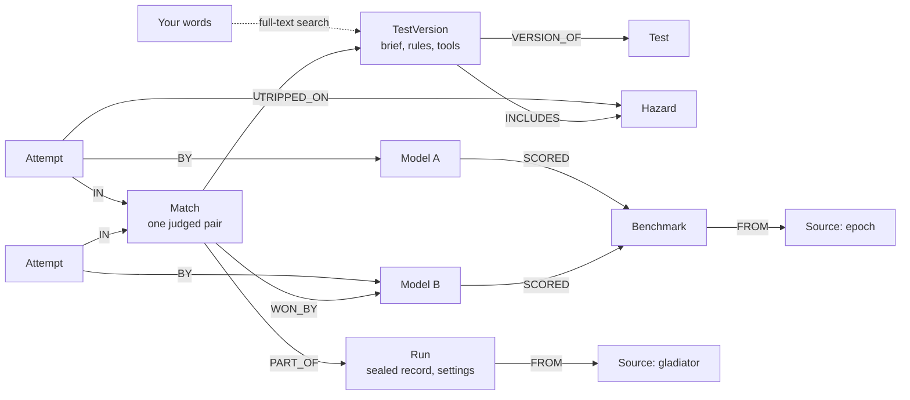

# Gladiator Ledger

**Of these two AI models, which does *this* task better, how sure is that, and what should I build?**

Two models that look alike on a leaderboard can behave very differently on your workflow. Ledger holds head-to-head
matches in a [Relate](https://relatedb.ai) graph, where two models played the same freshly generated worlds of a
tool-using task, and answers with a **task claim** in two parts: is each model **fit for this task** under your
tolerance for mistakes, and which one **did it better** head to head. Then it writes a **spec** you can build
from. It never ranks models in general, and when the evidence is thin or level it names no winner.

**Where Relate comes in.** [Relate](https://relatedb.ai) is the store and the query engine, not an export target.
The match records are loaded into one Relate graph, and every answer is a Cypher query over it. A Relate full-text
index finds the workflow you describe. Storage mode: the embedded Python library with a single-file store
(`data/ledger.rl`), opened read-only; the browser demo runs Relate's WebAssembly build with an in-memory store
built from the same statements; and an MCP server gives AI assistants the same graph, read-only.

> Entry for the Relate by Neo4j hackathon (Nov–Dec 2026). The repository ships a Relate store built from **37 real
> matches between 12 models** (closed and open-weights), so everything below reproduces from a clean clone with
> **no API keys and no cost**.

> **Costs corrected (2026-11-23).** A check of recorded costs against the providers' real bills found the engine
> had priced two kinds of call wrongly (Claude Haiku 5.5 about four times too high, models run through OpenRouter
> about 40% too low). Every cost here is now the provider's billed figure where one exists, and every scenario
> decided on efficiency was re-judged. What changed and how: [docs/DISCLOSURE.md](docs/DISCLOSURE.md).

## The idea in one table
Claude Haiku 5.5 and DeepSeek V4.1 Flash score 0.9 points apart on a published capability index: a tie on paper.
Here are the same two models on four workflows, sixteen judged pairs each, played on the same generated worlds.

| Task | Pairs won (Haiku / DeepSeek) | Attempts passed on the task (Haiku / DeepSeek) | For one person | For a business running it unattended |
|---|---|---|---|---|
| Refund queue | 11 / 5 | 81% / 37% | **Use Haiku**: DeepSeek is not fit | neither is fit |
| Access review | 5 / 11 | 96% / 96% | both fit, leaning DeepSeek | **Use DeepSeek**: Haiku is not fit |
| Inventory transfer | 5 / 11 | 85% / 93% | both fit, leaning DeepSeek | neither is fit |
| Incident triage | 9 / 7 | 87% / 96% | both fit, leaning Haiku | neither is fit |

One model is not "better". The two cost about the same per attempt (half a cent) and split their 64 pairs 30 to
34, yet task by task they are not level: on refunds DeepSeek fails 43 of 68 attempts by acting before it has read
the records, and on access reviews and inventory transfers it leads 11 to 5. And **the right answer depends on who
is asking**: a single wrong decision in 54 attempts is tolerable for one person and disqualifying for a business
moving money or access rights. Ledger makes both calls, shows the count behind each, says "leaning" when a lead
could still be chance, and lets you change the rule.

## Three ways to use it
All three walk the same loop over the same graph and give the same answers (the page is checked against the
command line in CI).

### 1. In your browser
**Live: https://loothore907.github.io/gladiator-ledger/** (published from this repository after every change that
passes the checks). The `site/` folder is a static page. It builds the graph in your browser with Relate's WebAssembly build and walks
the loop: describe a flow, pick two models, choose whose tolerance applies, read the verdict, download the spec. Every
scenario behind a verdict can be replayed as a race: both models on the same world, step by step, at the pace they
really ran.

**Live races (hackathon judges for now, coming soon for everyone).** Under the recorded scenarios the page can
ask a [Gladiator race runner](https://github.com/Loothore907/gladiator-core/blob/main/docs/DEPLOYMENT.md) for one
fresh scenario between the two models on screen. It first states what the record expects, then streams the race
as it happens, then says whether the result was in line with the record or against it. To run one on your own
machine with your own keys: start `gladiator serve` in a gladiator-core checkout with
`--origin http://localhost:8000`, then open the page with `?runner=http://127.0.0.1:8787`. No server, no keys, nothing leaves
the tab.

```bash
python3 -m http.server --directory site 8000    # then open http://localhost:8000
```

### 2. Through your own AI assistant
Ledger is an MCP server, so an assistant can walk the loop for you in plain language: *"I need a model for handling
refund requests. I'm using Haiku 5.5. What should I compare it with, and which is better at this?"*

```bash
uv run ledger mcp        # serves data/ledger.rl on stdio, read-only
```
This repository's `.mcp.json` registers it for clients that read project configuration (open the folder in Claude
Code and the `ledger` tools appear). For others, add:

```json
{"mcpServers": {"ledger": {"command": "uv", "args": ["run", "--directory", "/path/to/gladiator-ledger", "ledger", "mcp"]}}}
```
The tools are `find_flows`, `who_has_played`, `suggest_opponents`, `verdict`, `write_spec`, `describe_graph` and
`read_graph` (read-only Cypher). They call the same code as the command line. The server also sends the assistant
Ledger's rules: task claims only, "leaning" stays "leaning", and no winner the evidence does not name. Ledger needs
no API key; the assistant is yours. Step-by-step setup: [docs/ASSISTANT.md](docs/ASSISTANT.md).

### 3. From the command line
Needs Python 3.12+ and [uv](https://docs.astral.sh/uv/). Under five minutes; works the same on Linux, macOS and
Windows (CI checks Linux and Windows on every change).

```bash
git clone https://github.com/Loothore907/gladiator-ledger
cd gladiator-ledger
uv sync
uv run ledger verdict refund-queue --a "haiku 5.5" --b minimax-m3.1
```

## The loop, step by step

### Step 1. Describe your flow
```bash
uv run ledger flows "an agent that handles refund requests for damaged orders"
```
```text
Closest tested workflows to: 'an agent that handles refund requests for damaged orders'  (searched for: refund
requests damaged orders request order)      (output wrapped and shortened here)

  gladiator/refund-queue  (Refund queue, version 2.2.0)  match 6.03
    12 models, 205 judged pairs; modelled on tau-bench (style)
    You run the refund queue for an online shop. Go through every open refund request, look up its order ...

  gladiator/inventory-transfer  (Inventory transfer, version 1.2.0)  match 2.54
    ...
```
A keyword search (a Relate **full-text index** over each workflow's title, brief and rules) that then walks the
graph to what is known about each match: how many models and judged pairs stand behind it. When nothing matches it
says so and lists what exists. It never invents a match.

### Step 2. Pick a fair opponent
```bash
uv run ledger opponents "haiku 5.5" --open-only
```
```text
anthropic:claude-haiku-5-5  (Claude Haiku 5.5)
Epoch Capabilities Index: 160.3  (range 158.2 to 162.7)

Closest on paper, open weights only:
  model                                         score     gap  ranges overlap  weights  in Ledger
  epoch:Kimi K3.1 Pro                           161.2   +0.87  yes             open     no matches yet
  openrouter:deepseek/deepseek-v4.1-flash-1017  159.4   -0.92  yes             open     64 pairs already played against it
  ...
```
Ledger never ranks models by a published score. It uses one, [Epoch AI's](https://epoch.ai/benchmarks)
Capabilities Index, for a narrower question: which models are close enough on paper that a head-to-head is worth
running? Haiku and DeepSeek are less than one point apart, with overlapping ranges. Over all four workflows they
are close too (30 pairs to 34), but on the refund queue only one of them is fit for the job. **Close on paper,
different on the task**: that gap is what Ledger is for.

### Step 3. Get the verdict
```bash
uv run ledger verdict refund-queue --a "haiku 5.5" --b minimax-m3.1
```
```text
Use anthropic:claude-haiku-5-5: it is the only one of the two fit for this task, and it is ahead,
not settled.                                                           (output wrapped and shortened here)

Fit for this task (personal tolerance):
  anthropic:claude-haiku-5-5: fit. Passed 44 of 54 (81%; bar 80%).
      tolerated: wrong decision (serious) in 1 of 54
      tolerated: acted without reading (minor) in 9 of 54
  openrouter:minimax/minimax-m3.1-flash: NOT fit. Passed 53 of 67 (79%; bar 80%).
      because: passed 53 of 67 attempts (79%), under the 80% bar

Head to head: Leaning anthropic:claude-haiku-5-5
  15 judged pairs on the same generated worlds: anthropic:claude-haiku-5-5 won 7,
  openrouter:minimax/minimax-m3.1-flash won 5, 3 tied (sign test p = 0.7744)
```
**Fit comes first.** A model is fit for a task when it passes enough of its attempts and stays inside your
tolerance for faults. Every attempt the model made on the task counts, whoever the opponent was. Each fault has a
level: **unforgivable** (one attempt with it makes the model unfit, shown with its count), **serious** (fine if
rare) or **minor** (shown, never decides). The same fault is not equally serious everywhere: paying a refund twice
breaks a business, paging the on-call twice is an annoyance. Two tolerances ship, and every level can be overruled:

```bash
uv run ledger verdict refund-queue --a "haiku 5.5" --b minimax-m3.1 --profile enterprise
uv run ledger verdict refund-queue --a "haiku 5.5" --b minimax-m3.1 --unforgivable "acted without reading"
```
`personal` needs 80% of attempts passed and allows a serious fault in 10% of them; `enterprise` needs 90% and
allows 2%. The defaults are in [`ledger/policy.py`](ledger/policy.py).

**Then the head to head.** Only the pairs where these two met count. It is one of four: **better** (a settled
result), **leaning** (ahead, but it could still be chance), **no real difference shown**, or **not enough
evidence** (fewer than eight pairs). When neither model is fit, Ledger lists the tested models that are, cheapest
first, or says that none is.

### Step 4. Get the spec
```bash
uv run ledger spec refund-queue --a "haiku 5.5" --b minimax-m3.1 --out spec.md
```
One document in three layers:

- **Decision.** The answer to act on (here: use Haiku, the only one of the two that is fit, ahead but not
  settled), each model's fitness with its reasons, the pair counts, and the comparison.
- **Blueprint.** The job and the rules exactly as tested, the tools the flow needs, the settings the result holds
  for (reasoning effort, output limit, a hard budget of $0.12 per attempt), and for every hazard an autonomy call:
  **can run alone** where the chosen model never fell for it in these matches, **needs a guard** where it did,
  with the guard spelled out ("refuse an action on an item until the lookups it depends on have been made").
- **Evidence.** The sealed match records, the test's fingerprint and the engine version.

It ends with the same content as JSON, and it says plainly what it is: a result for this task, in a simulated world,
under these settings. A starting point for the real flow, to be tested again once built.

## How and why Relate is used
Relate is the store and the query engine, not an export target. Every answer above is a walk through connected
facts:



- **Why a graph.** A verdict is the set of matches where two models' attempts share a world. A fair opponent is a
  neighbour over a benchmark, joined to the pairs those two have already played. A guardrail is the difference
  between where a hazard *could* occur (test version → hazard) and where a model *fell* for it (attempt → hazard).
  A spec is all three paths, read off the same nodes. In a flat report each is a custom script; here each is one
  Cypher query (`ledger/questions.py`).
- **Storage.** Embedded Python library (`relate-db`), a single-file store (`data/ledger.rl`), opened read-only for
  every question. In the browser, the WebAssembly build with an in-memory store, built from the same statements.
- **Retrieval.** A full-text index over the workflow text, for "describe your flow".
- **Agents.** The same store served read-only over MCP, including free-form read-only Cypher.
- **Safe to rebuild.** The loader `MERGE`s on stable keys behind uniqueness constraints, so loading the same records
  again changes nothing. The records stay the master copy; the store is a view of them.
- **Bridges.** Evidence reaches the graph through a bridge (`ledger/bridges/`): a source reads its own files and
  hands back rows in one shared shape, and the loader links everything to its `Source`. Two ship: `gladiator`
  (matches and test validation) and `epoch` (published scores, used only to suggest opponents). Another source of
  the same kinds of evidence plugs in the same way (`uv run ledger ask sources`).

Graph: 11 kinds of node and 17 relationships. See [docs/SCHEMA.md](docs/SCHEMA.md).

## More questions the graph answers
The matches come from [Gladiator](https://github.com/Loothore907/gladiator-core), an open head-to-head evaluation
engine. Each pair of attempts is judged in order: success beats failure; if neither succeeds, getting further wins;
if both succeed, the more efficient wins; and no real difference is a tie. Ledger re-judges every pair with that rule.

**Across a whole suite, under a budget.**
```bash
uv run ledger recommend --suite small-tier --budget 0.05
```
```text
Leaning: openrouter:deepseek/deepseek-v4.1-flash-1017

  model                                        pairs  won  ties  passed  $/attempt  $/clean  mistakes
  openrouter:deepseek/deepseek-v4.1-flash-1017   272  212     1     218    $0.0047  $0.0059       0.9
  anthropic:claude-haiku-5-5                     216  147     3     189    $0.0045  $0.0052       0.4
  openrouter:minimax/minimax-m3.1-flash          268  132     3     177    $0.0093  $0.0140       1.8
  ...
Caveats:
  - deepseek leads claude-haiku-5-5 34-30, but a split like that happens by chance 71% of the time
    between equal models: a lean, not a settled result.
  - Beat cycles (2): nemotron > qwen > glm-5.3 > nemotron (9-3, 7-5, 7-5); ...
```
DeepSeek and Claude Haiku lead these four workflows at about half a cent per attempt, and their own head-to-head
is 34 to 30, so Ledger says **leaning**, not better, and shows why. Task by task the same two are not level (the
table at the top). A suite-wide answer pools different tasks and opponents, which is why the pair-by-pair verdict
above is the claim to rely on.

**Where models slip** (`uv run ledger ask hazard_profile`). For each model and each hazard a test can generate:
how many attempts met it, and how many fell for it. The commonest slip is acting without reading: deciding a
request before looking up the records it depends on (DeepSeek in 12 of 72 attempts; only one model never did it).
After an ambiguous timeout, ten of the twelve models always checked before retrying.

**Whether the ranking is even a ladder** (`uv run ledger ask beat_cycles`). On the same test, A beat B, B beat C and
C beat A. Ledger finds these cycles and reports each edge's score, so a cycle of 2-1 wins reads as possible noise.

**Whether a test can be trusted** (`uv run ledger ask promotion`). For each test version: did it pass automatic
validation (a reference player passes and every corner-cutting player is caught), how many models played it, and how
often a pair had a clear winner. The four current workflows each have 12 models, 84 pairs and 99–100% decisive pairs.

**Which results are out of date** (`uv run ledger ask stale_results`). Matches played on a test version that has
since been replaced. The shipped store holds current versions only, so this is empty today.

Every named question: `uv run ledger ask <name> --json` (`best_under_budget`, `head_to_head`, `hazard_profile`,
`beat_cycles`, `beats`, `promotion`, `stale_results`, `sources`, `close_to`, `pair_on_task`, `pair_hazards`,
`find_flow`, `flows`, `flow_as_tested`).

## What's in the data
`data/records/` holds the sealed public run records (`record.json`) of every match: two models, the same generated
worlds, every action, grade and cost. `data/validations/` holds the sealed validation records of each test version.
Beside each record sits its **private half** (`operator.json`): the answer key of every generated world, published
now that the match is over. Each public record carries a fingerprint of its private half, so anyone can check that
the two belong together and re-grade a match themselves:

```bash
uv run ledger verify     # 37 match records, every seal checked; 37 private halves checked against their fingerprint
```
A private half is published only for tests that generate a fresh world on every attempt, so the answers cannot help
anyone on a later match. A test fails if the store and the records ever disagree. To rebuild the store yourself and
check it gives the same answers:

```bash
uv run ledger build --records data/records --validations data/validations --scores data/epoch --store rebuilt.rl
uv run ledger recommend --suite small-tier --budget 0.05 --store rebuilt.rl
```

**Known limits.** Evidence is uneven. Thirteen pairings of small models have 12 to 16 judged pairs on every workflow,
enough for a verdict; the rest have met on 2 to 6 worlds per workflow and read "not enough evidence", which is
the honest reading: more matches turn them into claims. Results hold for the task as tested, in a simulated world; a workflow of yours
that only resembles one of these four needs its own test. The page and the assistant work over this fixed set of
finished matches and cannot run new ones.

`data/epoch/` holds one file from Epoch AI's Benchmarking Hub (the Capabilities Index), used under the Creative
Commons Attribution licence; see [data/epoch/README.md](data/epoch/README.md) for the credit.

## Before and during the contest
The contest opened on Nov 11, 2026. Everything in this repository was written after that.

| When | What | Where |
|---|---|---|
| October 2026 | The idea for Gladiator: head-to-head tests of two models on the same task. No code. | Not in any repository |
| Nov 18–20 | Gladiator's first code: a pilot runner and ten fixed test cases (its first commit is dated Nov 18). **Ledger does not use this version or its tests.** | Private history |
| Nov 20–22 | The Gladiator engine as Ledger's data uses it: the rebuilt match engine, the tool-workflow test type, the four workflow tests, automatic validation, the test suites, and every match in `data/`. Also two fixes found while building Ledger: the check tool's missing argument, and records naming the engine's own version. | [gladiator-core](https://github.com/Loothore907/gladiator-core), published Nov 22 with a fresh history |
| Nov 21 onward | **All of Ledger**: the bridges and loader, the graph schema, every Cypher question, the commands (`flows`, `opponents`, `verdict`, `spec`, `verify`, `recommend`), the MCP server, the browser demo page, the tests and the shipped store. | This repository |

- **What Ledger takes from Gladiator.** It reads Gladiator's output files (the sealed match and validation
  records). It imports no Gladiator code. One small file is copied from it and marked as such:
  `ledger/scoring.py`, the rule that judges a pair of attempts.
- **Who wrote it.** The code, tests and documentation in both projects were written by Claude (Anthropic) working
  as a coding agent under the owner's direction. The owner set the goals and made the product, budget and
  publishing decisions.
- **Not affiliated.** Ledger is independent. It is not affiliated with, sponsored by or endorsed by Anthropic,
  OpenAI, Google, OpenRouter or any model maker. Model names appear only to identify what was tested, and the match
  transcripts in `data/` are AI-generated.

Full statement: [docs/DISCLOSURE.md](docs/DISCLOSURE.md). The organizers' answer on eligibility: [docs/ELIGIBILITY.md](docs/ELIGIBILITY.md).

## License
Apache-2.0.
