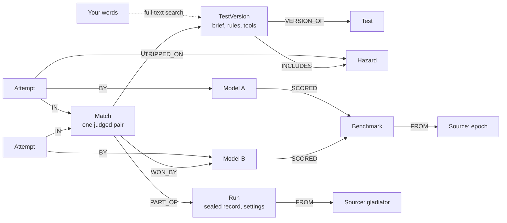

# Gladiator Ledger

**Of these two AI models, which does *this* task better, how sure is that, and what should I build?**

Two models that look alike on a leaderboard can behave very differently on your workflow. Ledger holds head-to-head
matches in a [Relate](https://relatedb.ai) graph, where two models played the same freshly generated worlds of a
tool-using task, and answers with a **task claim**: who did this task better, how sure that is, whether either is
good enough, and a **spec** you can build from. It never ranks models in general, and when the evidence is thin or
level it names no winner.

> Entry for the Relate by Neo4j hackathon (Nov–Dec 2026). The repository ships a Relate store built from **25 real
> matches between 12 models** (closed and open-weights), so everything below reproduces from a clean clone with
> **no API keys and no cost**.

## The idea in one table
Claude Haiku 5.5 and MiniMax M3.1 Flash, the same two models, on four workflows. Fifteen judged pairs each, played
on the same generated worlds.

| Task | Verdict | Pairs won (Haiku / MiniMax) | Attempts passed (Haiku / MiniMax) | Cost per attempt (Haiku / MiniMax) |
|---|---|---|---|---|
| Refund queue | **MiniMax does it better** | 3 / 12 | 15 / 12 of 15 | $0.017 / $0.003 |
| Access review | leaning MiniMax | 5 / 10 | 15 / 10 | $0.017 / $0.005 |
| Inventory transfer | leaning MiniMax | 5 / 10 | 12 / 10 | $0.024 / $0.012 |
| Incident triage | leaning Haiku | 11 / 4 | 13 / 3 | $0.015 / $0.005 |

One model is not "better". MiniMax handles refunds as well as you need at a fifth of the cost; on incident triage
it passes 3 attempts in 15. Only the first row is a settled result, and Ledger says so: the others are **leaning**,
because a 10–5 split still happens by chance about a third of the time.

## Three ways to use it
All three walk the same loop over the same graph and give the same answers (the page is checked against the
command line in CI).

### 1. In your browser
The `site/` folder is a static page. It builds the graph in your browser with Relate's WebAssembly build and walks
the loop: describe a flow, pick two models, read the verdict, download the spec. No server, no keys, nothing leaves
the tab.

```bash
python3 -m http.server --directory site 8000    # then open http://localhost:8000
```

### 2. Through your own AI assistant
Ledger is an MCP server, so an assistant can walk the loop for you in plain language: *"I need a model for handling
refund requests. I'm using Haiku 5.5. What should I compare it with, and which is better at this?"*

```bash
uv run ledger mcp        # serves data/ledger.rl on stdio, read-only
```
This repository's `.mcp.json` registers it for clients that read project configuration (open the folder in Claude
Code and the `ledger` tools appear). For others, add:

```json
{"mcpServers": {"ledger": {"command": "uv", "args": ["run", "--directory", "/path/to/gladiator-ledger", "ledger", "mcp"]}}}
```
The tools are `find_flows`, `who_has_played`, `suggest_opponents`, `verdict`, `write_spec`, `describe_graph` and
`read_graph` (read-only Cypher). They call the same code as the command line. The server also sends the assistant
Ledger's rules: task claims only, "leaning" stays "leaning", and no winner the evidence does not name. Ledger needs
no API key; the assistant is yours.

### 3. From the command line
Needs Python 3.12+ and [uv](https://docs.astral.sh/uv/). Under five minutes; works the same on Linux, macOS and
Windows (CI checks Linux and Windows on every change).

```bash
git clone https://github.com/Loothore907/gladiator-ledger
cd gladiator-ledger
uv sync
uv run ledger verdict refund-queue --a "haiku 5.5" --b minimax-m3.1
```

## The loop, step by step

### Step 1. Describe your flow
```bash
uv run ledger flows "an agent that handles refund requests for damaged orders"
```
```text
Closest tested workflows to: 'an agent that handles refund requests for damaged orders'  (searched for: refund
requests damaged orders request order)      (output wrapped and shortened here)

  gladiator/refund-queue  (Refund queue, version 2.2.0)  match 6.03
    12 models, 84 judged pairs; modelled on tau-bench (style)
    You run the refund queue for an online shop. Go through every open refund request, look up its order ...

  gladiator/inventory-transfer  (Inventory transfer, version 1.2.0)  match 2.54
    ...
```
A keyword search (a Relate **full-text index** over each workflow's title, brief and rules) that then walks the
graph to what is known about each match: how many models and judged pairs stand behind it. When nothing matches it
says so and lists what exists. It never invents a match.

### Step 2. Pick a fair opponent
```bash
uv run ledger opponents "haiku 5.5" --open-only
```
```text
anthropic:claude-haiku-5-5  (Claude Haiku 5.5)
Epoch Capabilities Index: 160.3  (range 158.2 to 162.7)

Closest on paper, open weights only:
  model                                         score     gap  ranges overlap  weights  in Ledger
  epoch:Kimi K3.1 Pro                           161.2   +0.87  yes             open     no matches yet
  openrouter:deepseek/deepseek-v4.1-flash-1017  159.4   -0.92  yes             open     24 pairs already played against it
  ...
```
Ledger never ranks models by a published score. It uses one, [Epoch AI's](https://epoch.ai/benchmarks)
Capabilities Index, for a narrower question: which models are close enough on paper that a head-to-head is worth
running? Haiku and DeepSeek are less than one point apart, with overlapping ranges. On these workflows DeepSeek won
20 of their 24 pairs. **Close on paper, clearly different on the task**: that gap is what Ledger is for.

### Step 3. Get the verdict
```bash
uv run ledger verdict refund-queue --a "haiku 5.5" --b minimax-m3.1
```
```text
Verdict: openrouter:minimax/minimax-m3.1-flash does this task better      (output wrapped here to fit)
  15 judged pairs on the same generated worlds: anthropic:claude-haiku-5-5 won 3,
  openrouter:minimax/minimax-m3.1-flash won 12, 0 tied (sign test p = 0.0352)
  decided: 12 on efficiency, 3 on success

  model                                  passed   $/attempt  sec/attempt  mistakes  good enough (bar 80%)
  anthropic:claude-haiku-5-5             15/15     $0.0174           33       0.0  yes
  openrouter:minimax/minimax-m3.1-flash  12/15     $0.0032           29       0.3  yes
```
Only the pairs where these two met count. The verdict is one of four: **better** (a settled result), **leaning**
(ahead, but it could still be chance), **no real difference shown**, or **not enough evidence** (fewer than eight
pairs). It also says whether each model is good enough against a bar you can set, where each one tripped, and which
sealed records back it.

### Step 4. Get the spec
```bash
uv run ledger spec refund-queue --a "haiku 5.5" --b minimax-m3.1 --out spec.md
```
One document in three layers:

- **Decision.** "Use `openrouter:minimax/minimax-m3.1-flash` for this task", the pair counts, and the comparison.
- **Blueprint.** The job and the rules exactly as tested, the tools the flow needs, the settings the result holds
  for (reasoning effort, output limit, a hard budget of $0.12 per attempt), and for every hazard an autonomy call.
  For this pair: MiniMax acted before reading the records in 2 of 15 attempts, so that step **needs a guard**
  ("refuse an action on an item until the lookups it depends on have been made"); duplicate actions, planted
  instructions and wrong amounts never happened, so those **can run alone**.
- **Evidence.** The sealed match records, the test's fingerprint and the engine version.

It ends with the same content as JSON, and it says plainly what it is: a result for this task, in a simulated world,
under these settings. A starting point for the real flow, to be tested again once built.

## How and why Relate is used
Relate is the store and the query engine, not an export target. Every answer above is a walk through connected
facts:



- **Why a graph.** A verdict is the set of matches where two models' attempts share a world. A fair opponent is a
  neighbour over a benchmark, joined to the pairs those two have already played. A guardrail is the difference
  between where a hazard *could* occur (test version → hazard) and where a model *fell* for it (attempt → hazard).
  A spec is all three paths, read off the same nodes. In a flat report each is a custom script; here each is one
  Cypher query (`ledger/questions.py`).
- **Storage.** Embedded Python library (`relate-db`), a single-file store (`data/ledger.rl`), opened read-only for
  every question. In the browser, the WebAssembly build with an in-memory store, built from the same statements.
- **Retrieval.** A full-text index over the workflow text, for "describe your flow".
- **Agents.** The same store served read-only over MCP, including free-form read-only Cypher.
- **Safe to rebuild.** The loader `MERGE`s on stable keys behind uniqueness constraints, so loading the same records
  again changes nothing. The records stay the master copy; the store is a view of them.
- **Bridges.** Evidence reaches the graph through a bridge (`ledger/bridges/`): a source reads its own files and
  hands back rows in one shared shape, and the loader links everything to its `Source`. Two ship: `gladiator`
  (matches and test validation) and `epoch` (published scores, used only to suggest opponents). Another source of
  the same kinds of evidence plugs in the same way (`uv run ledger ask sources`).

Graph: 10 kinds of node and 13 relationships. See [docs/SCHEMA.md](docs/SCHEMA.md).

## More questions the graph answers
The matches come from [Gladiator](https://github.com/Loothore907/gladiator-core), an open head-to-head evaluation
engine. Each pair of attempts is judged in order: success beats failure; if neither succeeds, getting further wins;
if both succeed, the more efficient wins; and no real difference is a tie. Ledger re-judges every pair with that rule.

**Across a whole suite, under a budget.**
```bash
uv run ledger recommend --suite small-tier --budget 0.05
```
```text
Leaning: openrouter:deepseek/deepseek-v4.1-flash-1017

  model                                        pairs  won  ties  passed  $/attempt  $/clean  mistakes
  openrouter:deepseek/deepseek-v4.1-flash-1017    72   52     1      59    $0.0065  $0.0079       0.5
  openrouter:minimax/minimax-m3.1-flash          108   61     0      69    $0.0075  $0.0117       1.7
  anthropic:claude-haiku-5-5                     132   70     0     118    $0.0185  $0.0207       0.4
  ...
Head to head vs openrouter:minimax/minimax-m3.1-flash: 14-10 (sign test p = 0.5413)
Caveats:
  - deepseek leads minimax 14-10, but a split like that happens by chance 54% of the time between equal
    models: a lean, not a settled result.
  - Beat cycles (2): claude-haiku-5-5 > gemini-3.1-flash-lite > gpt-6-luna > claude-haiku-5-5 (4-0, 2-1, 3-2); ...
```
Two open-weights models lead Claude Haiku on these four workflows at well under half the cost per attempt. Between
the two leaders, DeepSeek is ahead of MiniMax 14-10 head to head, which is too close to call, so Ledger says
**leaning** and shows why. A suite-wide answer pools different opponents, which is why the pair-by-pair verdict
above is the claim to rely on.

**Where models slip** (`uv run ledger ask hazard_profile`). For each model and each hazard a test can generate:
how many attempts met it, and how many fell for it. The commonest slip is acting without reading: deciding a
request before looking up the records it depends on (DeepSeek in 12 of 72 attempts; only one model never did it).
After an ambiguous timeout, ten of the twelve models always checked before retrying.

**Whether the ranking is even a ladder** (`uv run ledger ask beat_cycles`). On the same test, A beat B, B beat C and
C beat A. Ledger finds these cycles and reports each edge's score, so a cycle of 2-1 wins reads as possible noise.

**Whether a test can be trusted** (`uv run ledger ask promotion`). For each test version: did it pass automatic
validation (a reference player passes and every corner-cutting player is caught), how many models played it, and how
often a pair had a clear winner. The four current workflows each have 12 models, 84 pairs and 99–100% decisive pairs.

**Which results are out of date** (`uv run ledger ask stale_results`). Matches played on a test version that has
since been replaced. The shipped store holds current versions only, so this is empty today.

Every named question: `uv run ledger ask <name> --json` (`best_under_budget`, `head_to_head`, `hazard_profile`,
`beat_cycles`, `beats`, `promotion`, `stale_results`, `sources`, `close_to`, `pair_on_task`, `pair_hazards`,
`find_flow`, `flows`, `flow_as_tested`).

## What's in the data
`data/records/` holds the sealed public run records (`record.json`) of every match: two models, the same generated
worlds, every action, grade and cost. `data/validations/` holds the sealed validation records of each test version.
Beside each record sits its **private half** (`operator.json`): the answer key of every generated world, published
now that the match is over. Each public record carries a fingerprint of its private half, so anyone can check that
the two belong together and re-grade a match themselves:

```bash
uv run ledger verify     # 25 match records, every seal checked; 25 private halves checked against their fingerprint
```
A private half is published only for tests that generate a fresh world on every attempt, so the answers cannot help
anyone on a later match. A test fails if the store and the records ever disagree. To rebuild the store yourself and
check it gives the same answers:

```bash
uv run ledger build --records data/records --validations data/validations --scores data/epoch --store rebuilt.rl
uv run ledger recommend --suite small-tier --budget 0.05 --store rebuilt.rl
```

**Known limits.** Most pairs of models have met on 2 to 6 worlds per workflow, which is too few for a verdict;
only Haiku and MiniMax have 15. So most verdicts today read "not enough evidence", and that is the honest reading:
more matches turn them into claims. Results hold for the task as tested, in a simulated world; a workflow of yours
that only resembles one of these four needs its own test. The page and the assistant work over this fixed set of
finished matches and cannot run new ones.

`data/epoch/` holds one file from Epoch AI's Benchmarking Hub (the Capabilities Index), used under the Creative
Commons Attribution licence; see [data/epoch/README.md](data/epoch/README.md) for the credit.

## Disclosure
Ledger was started during the contest. It reads output from Gladiator, the owner's earlier engine, and copies one
small piece of its scoring code (marked in `ledger/scoring.py`). Code was written by Claude (Anthropic) under the
owner's direction. Full statement: [docs/DISCLOSURE.md](docs/DISCLOSURE.md).

## License
Apache-2.0.
